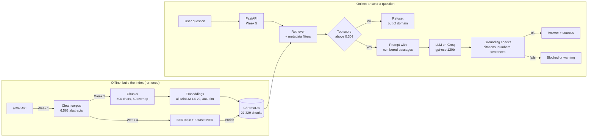
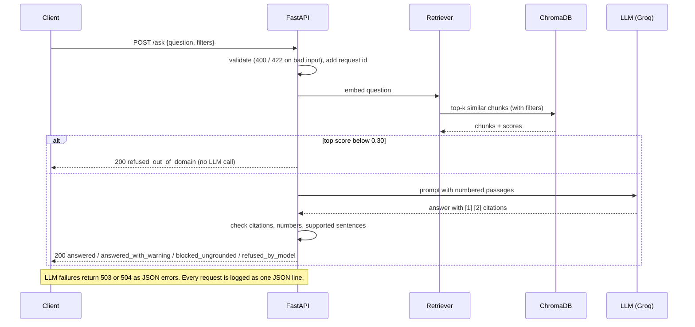
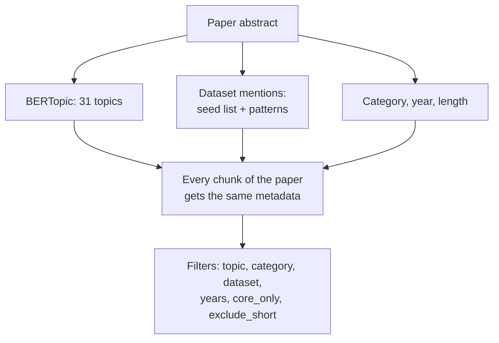

# Parallax Labs AI/ML Internship: Research-Paper RAG System

A retrieval-augmented generation (RAG) system that answers questions about machine learning research. It searches 6,563 arXiv abstracts and asks an LLM to answer **only from the passages it found**, with numbered citations. If the papers do not contain the answer, it refuses instead of guessing.

It was built over 6 weeks. Each week has its own folder, README and tests; this page is the single entry point for the whole project.

## Results at a glance

| What | Result |
|---|---|
| Corpus | 6,563 arXiv abstracts, 5 categories, 27,329 chunks |
| Finding the right paper (200 known-item queries) | Recall@1 0.825, Recall@5 0.905, MRR 0.863 |
| Topical queries judged by hand (20) | Precision@5 0.870, MRR 0.950 |
| Search speed (CPU) | about 56 ms mean, 74 ms p95 |
| End-to-end test over HTTP (40 requests) | 40 of 40 passed, 0 server errors |
| Full answer time | about 1.3 s mean, 1.7 s p95 (most of it is the LLM) |
| Out-of-scope questions refused | 100% (13 of 13 in the end-to-end test) |
| Unit tests | 186 in Week 5 (no key, data or network needed) |

All details, tables, definitions and limits: **[docs/EVALUATION.md](docs/EVALUATION.md)**.

## Weekly progress

| Week | Folder | Topic |
|---|---|---|
| 1 | [week-1](week-1/) | Environment setup, arXiv dataset, text cleaning |
| 2 | [week-2](week-2/) | Chunking, embeddings, ChromaDB, semantic search, benchmark |
| 3 | [week-3](week-3/) | LLM integration, prompts, guardrails, hallucination checks |
| 4 | [week-4](week-4/) | Topic modelling, dataset extraction, metadata filters |
| 5 | [week-5](week-5/) | FastAPI service, logging, evaluation, tests |
| 6 | this page, [docs](docs/) | Docstrings and type hints everywhere, documentation, reproducible setup |

## Architecture

### The whole system

Offline steps build the index once. Online steps run for every question.



### What happens on `POST /ask`



### Metadata flow (Week 4)



## Repository layout

```
.
├── README.md                this page
├── requirements.txt         one install for all weeks
├── docs/
│   ├── EVALUATION.md        all metrics and benchmarks
│   └── check_numbers.py     checks EVALUATION.md against the logs
├── week-1/                  data download, cleaning       (scripts/, src/, tests/)
├── week-2/                  chunking, embeddings, ChromaDB (scripts/, src/, tests/, logs/)
├── week-3/                  RAG core: rag/ (retriever, prompts, LLM client, guardrails, pipeline), scripts/, logs/
├── week-4/                  nlpmeta/ (topics, NER, filters, labeling), scripts/, labels/, logs/
└── week-5/                  api/ (FastAPI app), evals/, scripts/, tests/, eval_data/, logs/
```

Code in later weeks imports from earlier ones, so keep all week folders side by side.

## Setup

You need Python 3.11 (the results were produced with 3.11.5), about 5 GB of free disk space and an internet connection for the first run. No GPU is needed.

**1. Get the code and create an environment**

```bash
git clone https://github.com/NoorFatima-14/Parallax-internship.git
cd Parallax-internship
python -m venv .venv
source .venv/bin/activate          # Windows: .venv\Scripts\activate
python -m pip install --upgrade pip
```

**2. Install the packages** (optional first step to save disk space: CPU-only PyTorch)

```bash
pip install torch==2.14.1 --index-url https://download.pytorch.org/whl/cpu
pip install -r requirements.txt
python -m spacy download en_core_web_sm
```

**3. Add your LLM key.** Get a free key at https://console.groq.com, then:

```bash
cp week-3/.env.example week-3/.env      # Windows: copy week-3\.env.example week-3\.env
# open week-3/.env and put the key after GROQ_API_KEY=
```

Never commit `.env` (it is in `.gitignore`).

**4. Check that the setup is sound**

```bash
cd week-5 && pytest -q && cd ..
```

The 186 Week 5 tests use a fake model and a fake LLM, so they need no key, no data and no network. They should all pass (5 Week 4 tests skip if spaCy or BERTopic is missing).

**5. Build the data** (only once, about 40 minutes on a laptop CPU). The corpus and the vector database are not stored in git, so you create them:

```bash
cd week-1
python scripts/download_data.py --per-category 1500      # downloads from arXiv
python scripts/build_clean_corpus.py
cd ../week-2
python scripts/ingest.py --reset                         # chunks, embeds (about 25 min), fills ChromaDB
cd ../week-4
python scripts/run_topic_model.py                        # about 2 min
python scripts/run_ner.py                                # about 10 min
python scripts/enrich_vector_db.py                       # about 20 s, writes topics and datasets into ChromaDB
cd ..
```

> **Note:** arXiv returns the newest papers, so a new download gives a different corpus than the one in the reported results. Numbers will be close but not identical. See [docs/EVALUATION.md](docs/EVALUATION.md), "Reproducibility notes".

**6. Check the setup again with real data**

```bash
cd week-5
python scripts/check_setup.py
```

## Run it

**Start the API** (from `week-5/`):

```bash
uvicorn api.main:create_app --factory --port 8000 --no-access-log
```

Open http://127.0.0.1:8000/docs for the interactive documentation. `GET /ready` shows the chunk count, model and settings.

**Or use the command line** (from `week-3/`, no server needed):

```bash
python scripts/ask.py "How do diffusion models generate images?"
python scripts/ask.py            # interactive mode
```

## Example queries

### Ask a question

```bash
curl -X POST http://127.0.0.1:8000/ask -H "Content-Type: application/json" \
  -d '{"question": "How do diffusion models generate images?"}'
```

Real answer from the evaluation run (status `answered`, top score 0.6835):

> Diffusion models begin with pure random noise and then progressively remove the noise step-by-step, transforming the noisy input into a coherent image as the sampling process proceeds [1][3].

The response also lists the `sources` behind [1] and [3], the `timings_ms`, and the grounding result.

### Ask with filters

```bash
curl -X POST http://127.0.0.1:8000/ask -H "Content-Type: application/json" \
  -d '{"question": "What methods estimate uncertainty?", "filters": {"topics": ["uncertainty"], "core_only": true}}'
```

### Search only (no LLM, fast)

```bash
curl -X POST http://127.0.0.1:8000/search -H "Content-Type: application/json" \
  -d '{"query": "object detection", "top_k": 5, "filters": {"categories": ["cs.CV"]}}'
```

### Out-of-scope question: refused

```bash
curl -X POST http://127.0.0.1:8000/ask -H "Content-Type: application/json" \
  -d '{"question": "What is the best recipe for chocolate cake?"}'
```

> I can only answer questions about the indexed arXiv papers (computer science and machine learning), and I could not find relevant passages for this question.

(status `refused_out_of_domain`, top score 0.2431, no LLM call, about 90 ms). If a question passes the gate but the papers do not contain the answer (for example "How many parameters does GPT-4 have?"), the model says `I don't know based on the provided documents.` (status `refused_by_model`).

### More questions that work (from the evaluation)

- What methods are used for object detection in images?
- How is uncertainty estimated in deep neural networks?
- What methods exist for out-of-distribution detection?
- How do researchers reduce hallucinations in language models?
- What approaches make transformer models more efficient?

## API summary

| Endpoint | Purpose |
|---|---|
| `POST /ask` | Full RAG answer with sources and checks |
| `POST /search` | Retrieval only |
| `GET /topics` | The 31 topics |
| `GET /datasets` | Known datasets with document counts |
| `GET /health` | Alive check |
| `GET /ready` | Data loaded, model, settings |

Errors always have the same JSON shape: `400` bad request, `404`/`405` wrong path or method, `422` invalid fields, `500` internal error, `503` LLM unavailable, `504` LLM timeout. Details are in [week-5/README.md](week-5/README.md).

## Evaluation: how to re-run it

| What | Command (folder) | Writes |
|---|---|---|
| Retrieval speed | `python scripts/benchmark_retrieval.py` (week-2) | logs/benchmark_summary.md |
| RAG answers | `python scripts/evaluate_rag.py` (week-3) | logs/rag_eval_summary.md |
| Hallucination checks | `python scripts/test_hallucination_checks.py` (week-3) | logs/hallucination_check_summary.md |
| Topic labels | `python scripts/evaluate_labels.py` (week-4) | logs/nlp_metadata_evaluation.md |
| Filters | `python scripts/benchmark_filters.py` (week-4) | logs/filter_benchmark.md |
| Retrieval quality | `python scripts/evaluate_retrieval.py` (week-5) | logs/retrieval_eval.md |
| End to end | start the API, then `python scripts/evaluate_e2e.py` (week-5) | logs/e2e_eval.md |

The LLM-based ones need your key and use the free tier; `--delay 15` slows the pace if you hit rate limits. Check the documentation against the logs with `python docs/check_numbers.py`.

## Testing and code quality

- Run `pytest -q` inside `week-1`, `week-2`, `week-3`, `week-4` and `week-5`.
- Every function and module in Weeks 1 to 5 has a docstring and type hints; Weeks 3, 4 and 5 pass `mypy --ignore-missing-imports --follow-imports=silent --explicit-package-bases`.

## Known limits

- Abstracts only, no full papers; 5 arXiv categories.
- Hallucination checks are rule based; one of eight "answer to another question" cases got through in a test.
- Dataset-mention extraction is modest (F1 0.50 on 50 hand-labelled papers).
- Small hand-labelled samples; see the intervals in [docs/EVALUATION.md](docs/EVALUATION.md).
- Answers depend on an external LLM service and its free-tier limits.

## Troubleshooting

| Problem | Fix |
|---|---|
| `/ready` returns 503 | The ChromaDB folder is missing or empty. Run step 5 of the setup. |
| `llm_*` error or 503 on `/ask` | Key missing or wrong in `week-3/.env`, or a rate limit. Wait a minute and retry. |
| `ModuleNotFoundError: nlpmeta` or `rag` | Run commands from inside the week folder, as shown above. |
| spaCy model not found | `python -m spacy download en_core_web_sm` |
| Install conflict | Use a fresh venv with Python 3.11 and the versions in `requirements.txt`. |

## 5-minute demo

1. Start the API and open `/docs`.
2. `GET /ready`: show 27,329 chunks and the settings.
3. Ask "How do diffusion models generate images?": point to the citations and `sources`.
4. Ask the chocolate cake question: show the refusal without an LLM call.
5. Ask with a topic filter: show `filter_applied` and that all sources match.
6. Open `docs/EVALUATION.md`: show the 40 of 40 end-to-end result and the limits.
